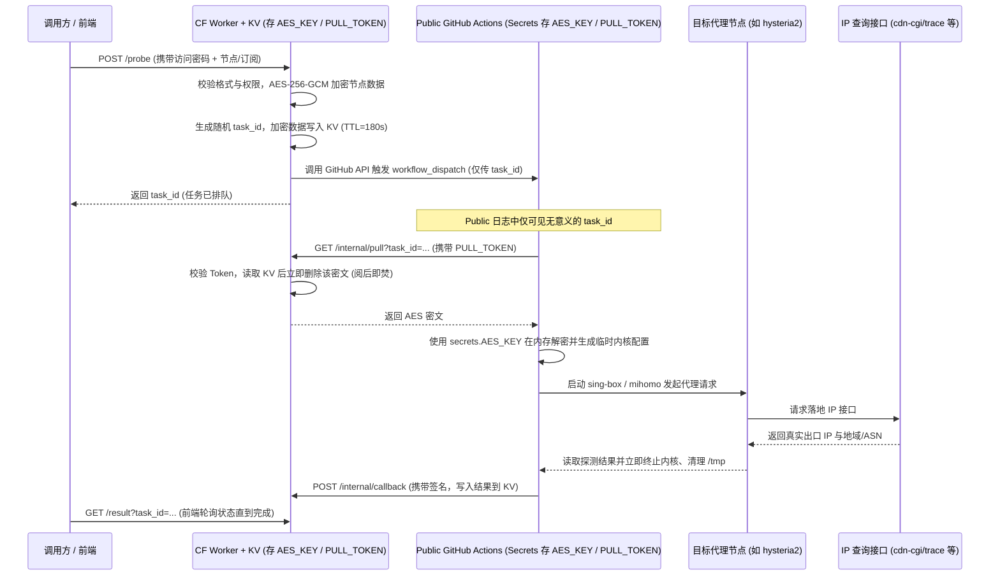

# 动态探测节点落地 IP 思路（CF Worker + Public GitHub Actions）

## 1. 背景与定位

### 1.1 为什么不直接在 Cloudflare Workers 中探测

纯 Cloudflare Workers 运行在 V8 Isolate 沙箱中，存在以下硬性限制：

1. **不支持出站 UDP / QUIC**：`cloudflare:sockets`（`connect()`）仅支持出站 TCP，无法连接 `hysteria2`、TUIC、WireGuard 等基于 UDP/QUIC 的节点。
2. **无法运行成熟代理内核**：不能直接执行 `sing-box` 或 `mihomo` 二进制，手写 JS/WASM 协议栈难以覆盖 Reality、端口跳跃（`ports` / `mport`）等特性。
3. **禁止回连 Cloudflare IP 段**：`connect()` 无法探测套了 Cloudflare CDN 的 WebSocket / gRPC 节点。

### 1.2 动态版方案目标

在**不购买 VPS、不消耗私有仓库有限免费分钟数**的前提下，实现：

- 支持随时提交单个新节点或整条订阅，动态探测节点**最终出口（落地）IP**；
- 支持全协议（含 `hysteria2` 等 UDP 节点）；
- 在 **Public 公开仓库** 下不泄露节点服务器、端口、密码或认证密钥等任何敏感信息。

核心思路是**控制面与执行面分离**：
- **Cloudflare Worker（控制面）**：鉴权、节点校验、加密/暂存任务、触发 GitHub Actions、接收回调、向前端返回结果。
- **Public GitHub Actions（执行面）**：在 `ubuntu-latest` 完整 Linux 环境中运行 `sing-box` / `mihomo` 完成真实出站探测，只发几十 KB 请求，测完即销毁。

---

## 2. 整体架构与数据流

### 2.1 方案一：密文直传模式（适合单节点 / 少量节点）

Worker 用 `AES-256-GCM` 将节点配置加密后直接放进 `workflow_dispatch` 参数，Runner 用仓库 Secrets 中的同一把密钥解密。

### 2.2 方案二：一次性取件码模式（推荐，适合批量节点 / 整条订阅）

由于 GitHub `workflow_dispatch` 的 `inputs` 有体积和字符长度限制，动态版更推荐**一次性取件码（`task_id`）模式**：

---

## 3. 核心实现思路拆解

### 3.1 Cloudflare Worker 侧职责

1. **接口鉴权与防刷**
   - `POST /probe` 必须校验用户访问 Token，避免公开接口被刷导致 GitHub API 限流或 Actions 滥用风控。
   - 对同一节点或同一用户增加短时间限流/缓存（例如同一节点 5 分钟内直接复用 KV 里的历史探测结果）。
2. **输入预处理（前置拦截无效输入）**
   - 在触发 Runner 前先做基础解析（支持 Clash YAML 单行/列表或常见分享链接），提取关键字段并在 Worker 层完成格式校验，减少无效触发浪费 20~30 秒冷启动时间。
3. **最小权限 GitHub Token**
   - 在 GitHub 申请 **Fine-grained Personal Access Token**，只勾选该单一公开仓库，权限仅授予 `Actions: Read and write`（触发 `workflow_dispatch`、可选查询或清理 Run 状态）。
4. **内部通信接口（`/internal/pull` 与 `/internal/callback`）**
   - 使用独立的 `PULL_TOKEN` / `CALLBACK_SECRET`（与用户访问 Token 分离），分别保存在 Worker 环境变量和 GitHub Repo Secrets 中。
   - `/internal/pull` 做到**单次有效 + 短 TTL**：即使 Runner 异常中断，未拉取的数据也会在 2~3 分钟内自动过期。

### 3.2 GitHub Actions（Runner）侧职责

1. **内核选型与加速启动**
   - 推荐 **`sing-box`** 或 **`mihomo`**：两者对 `hysteria2`（含端口跳跃 `ports` / `mport`）、TUIC、Reality、VLESS、Trojan、SS 等支持完善。
   - 在 Workflow 中使用 `actions/cache` 缓存内核二进制文件，避免每次运行都重新从 GitHub Releases 下载，缩短冷启动时间。
2. **临时出站探测流程**
   - 将解密后的节点组装成最小代理配置，同时开启一个本地混合/SOCKS5 入站端口（如 `127.0.0.1:10808`），**只绑定回环地址**。
   - 启动内核后轮询检测 `127.0.0.1:10808` 端口就绪（超时如 5 秒），避免固定 `sleep` 拖慢速度或启动未完成就报错。
   - 使用 `curl --socks5-hostname 127.0.0.1:10808` 请求 IP 探测接口，设置严格超时（如 `--connect-timeout 8 --max-time 12`）。
3. **多源 IP 检测与双栈识别**
   - 建议准备 2~3 个备选接口防止单一站点限流或对数据中心 IP 弹验证：
     - `https://www.cloudflare.com/cdn-cgi/trace`（极快、纯文本 `ip=` / `loc=`）
     - `https://api.ipify.org?format=json` / `https://api64.ipify.org?format=json`
     - `http://ip-api.com/json`（可直接附带国家、城市、ISP、ASN 信息）
   - 若需要区分 IPv4 / IPv6 落地，可分别强制 `-4` 与 `-6` 请求探测。
4. **批量节点并发控制**
   - 若一次探测多个节点，可以每个节点分配独立的本地入站端口（或使用内核的 API / 多出站策略组），控制合理并发数（如 5~10 并发）避免握手拥塞。

---

## 4. Public 公开仓库必须注意的安全细节

在公开仓库跑任何带节点信息的任务，**核心原则是：任何会出现在 GitHub 网页、Commit、Run 参数或控制台日志里的内容，都视为全世界可见。**

| 风险点 | 常见踩坑 | 正确做法 |
| :--- | :--- | :--- |
| **加密 vs 简单编码** | 用 Base64、XOR、字符映射表隐藏节点，但解码逻辑写在公开仓库里 | 必须使用标准对称加密（如 **AES-256-GCM**），密钥只放 `${{ secrets.AES_KEY }}` |
| **`workflow_dispatch` 明文暴露** | 把节点配置或明文密码传进 `inputs`，以为用 `::add-mask::` 能遮住 | `workflow_dispatch` 的 `inputs` 会在 Actions UI 和 `Set up job` 阶段明文展示，且 `::add-mask::` **无法遮罩触发输入**；只传 `task_id` 或 AES 密文 |
| **内核日志泄露原文** | `sing-box` / `mihomo` 配置出错时把配置文件或连接报错信息打印到 stdout | 将内核日志级别设为 `fatal` / `error`，或将 stdout/stderr 重定向到 `/dev/null`（仅捕获退出码与外部 `curl` 返回） |
| **配置文件残留或误上传** | 将临时配置写到工作目录，或使用 `actions/upload-artifact` 调试 | 配置文件只写入 `/tmp`，使用 `trap 'rm -f /tmp/...' EXIT` 确保退出必删，严禁上传 Artifacts |
| **探测结果隐私** | 在 Runner 控制台直接 `echo` 出节点名字和落地 IP | Runner 不打印落地 IP 明文，直接通过 HTTPS POST 加密/签名回传给 CF Worker，日志只输出 `task_id completed` |
| **第三方 PR 触发** | 仓库配置了 `pull_request` / `pull_request_target` 等不安全触发器 | 公开仓库仅保留 `workflow_dispatch`（仅仓库拥有者/授权 Token 可触发），不开启不必要的 PR 工作流 |

---

## 5. 工程与运行限制注意事项

1. **异步等待体验（非毫秒级 API）**
   - GitHub Actions 从 API 触发到 Runner 开始执行通常有 **10 ~ 30 秒**调度和初始化延迟，加上下载/恢复缓存和握手探测，完整链路耗时约 **15 ~ 45 秒**。
   - 前端交互应设计为“提交任务 → 展示加载状态 → 每 2~3 秒轮询 Worker 状态接口”，不要在一个 HTTP 请求里同步死等结果（CF Worker 免费版容易超时断开）。
2. **GitHub 队列与并发上限**
   - 免费账户并发 Job 数量有限，同时触发大量 `workflow_dispatch` 会排队。Worker 侧可尽量把同一批提交的多个节点合并进一个 `task_id` 里让单次 Runner 并发测完。
3. **测出来的“延迟”不代表本地直连速度**
   - GitHub-hosted Runner 位于美国云厂商机房，**最终落地 IP 结论是准确的**（出口只取决于节点服务器本身），但握手耗时和延迟反映的是 **美国机房 → 节点入口 → 落地** 的路径。
   - **极端情况**：极少数仅允许国内/亚洲 IP 连接的直连节点入口防火墙，可能会拦截来自美国 Runner IP 的入站连接，导致误判超时。
4. **历史记录清理与合规边界**
   - **定期清理 Run 记录**：虽然日志已脱敏，仍可通过 Worker 定时调用 GitHub API 删除历史 Workflow Runs，保持公开仓库整洁。
   - **合规使用**：仅作为短连接探测工具（单节点几 KB 流量、跑完即停），不要把探测端点开放给匿名陌生人无限使用，也不要利用 Runner 建立长连接转发流量。
